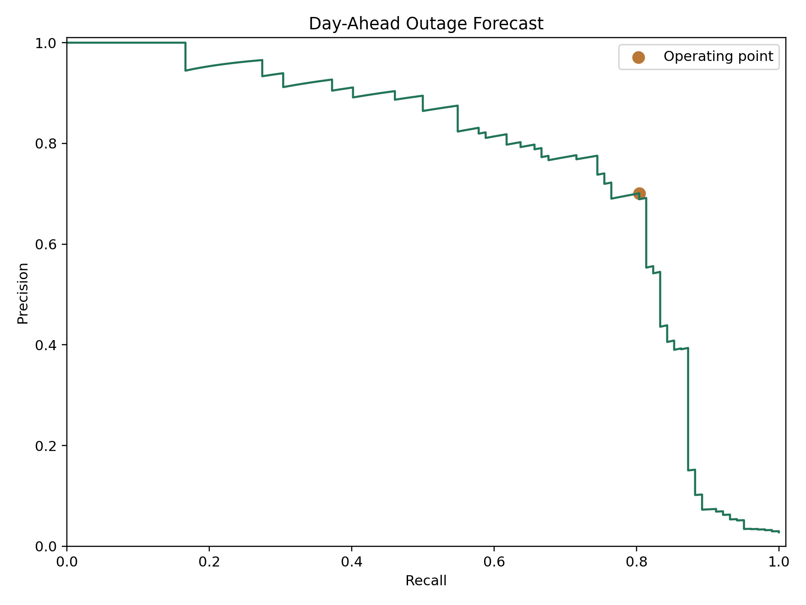
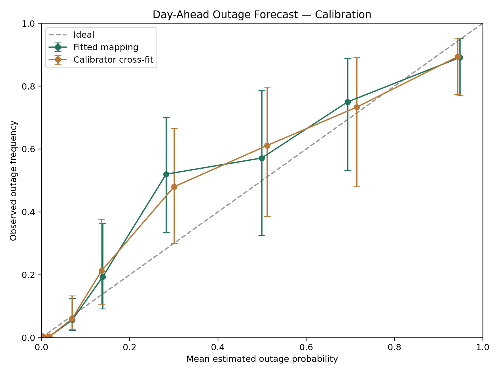

# Day-Ahead Outage Forecast

## Purpose

Estimate the probability of an outage for each recloser on the next local calendar day. The issue cutoff is D-1 at 20:00 Asia/Manila. Outputs are a percentage estimate, a Low/Medium/High risk label, and a binary warning. This package contains the frozen model and inference code.

## Model specification

| Component | Specification | Probability weight |
| --- | --- | --- |
| Extra Trees A | 4,735 trees; minimum leaf 1; max-features fraction 1; outage sample weight 1 | 0.59985000 |
| Extra Trees B | 2,400 trees; minimum leaf 1; max-features fraction 0.7; outage sample weight 50 | 0.39990000 |
| Logistic regression | C=0.1; equal class weights; maximum 3,000 iterations | 0.00025000 |

The component probabilities are combined using fixed weights. The logistic component supplies continuous input-dependent variation where tree scores are tied. Beta calibration maps the combined score to the reported outage percentage. Each record uses the same fitted transformations; percentages are not manually assigned.

Forest numeric inputs use fitted median imputation and categorical inputs use fitted mode imputation followed by one-hot encoding. The logistic component uses numeric median imputation, missingness indicators, standardization, and explicit categorical missing values. All preprocessing is stored in the model. Previously unseen categories are ignored by the fitted encoder.

## Dataset and methods

| Cohort | Records | Outages | Non-outages | Dates |
| --- | --- | --- | --- | --- |
| Historical observations | 6906 | 295 | 6611 | 2024-01-01 to 2025-09-16 |
| Earlier validation | 839 | 46 | 793 | 2025-10-01 to 2025-12-17 |
| Assessment | 3682 | 102 | 3580 | 2026-01-01 to 2026-09-21 |

Each forest fits 17,646 records: 6,906 historical observations and 10,740 forecast-window training variants, with 295 outage and 17,351 non-outage labels. Weather noise is 0.001 historical-training IQR for forest A and 0.003 IQR for forest B. The logistic component fits 7,791 records: 6,906 historical observations and 885 historical outage-window variants, giving 1,180 outage and 6,611 non-outage labels. Its weather noise is 0.01 IQR. Variant labels are inherited from their parents; the variants are not independent observed incidents.

Weather histories and interactions are recomputed after perturbing the D-7 through D forecast window. Humidity bounds, nonnegative rainfall/wind, and temperature ordering are maintained. Calendar, recloser identity, vegetation, notice history, and weather code retain parent values.

**Evaluation scope.** Known assessment non-outages supply training variants, and assessment outcomes inform model weights, warning thresholds, and calibration. The results therefore describe this assessment period and do not establish independent future performance. The five-fold date-grouped calibration check holds out calibrator fitting rows only.

## Inputs and forecast timing

The model accepts 66 prepared input features, plus the provenance fields specified in `feature_schema.json`. All weather-related features use archived fixed-48-hour forecasts rather than observed target-day weather. Forecast-derived histories cover D-7 through D. Vegetation uses a two-month lag, and notice-history inputs must use publications available by the prediction cutoff. Exact forecast release times and satellite-product availability were not verified in the assessment.

The scoring code accepts prepared features. It does not fetch weather or construct vegetation and notice histories. Future inputs require current forecast coverage and an operator-attested notice snapshot. The supplied example is historical, not a live forecast.

## Results

| Metric | Value | 95% date-cluster bootstrap interval |
| --- | --- | --- |
| Precision | 70.09% | 60.19% to 80.33% |
| Recall | 80.39% | 71.17% to 88.04% |
| F1-score | 0.748858 | 0.663260 to 0.817400 |
| ROC-AUC | 0.929102 | 0.888177 to 0.963735 |
| Brier score | 0.011488 | 0.008390 to 0.014871 |

Confusion matrix: **TP 82, FP 35, FN 20, TN 3545**. Average precision is **0.757283** and log loss is **0.051545**. High risk is the positive warning class. The assessment point estimates meet the minimum 80% recall and 70% precision objective. Confidence intervals use 1,000 resamples of whole dates and do not account for all model-selection uncertainty.



## Probability outputs and risk labels

| Risk label | Estimated outage percentage |
| --- | --- |
| Low | Below 6.01570853% |
| Medium | 6.01570853% to below 15.08727544% |
| High | At least 15.08727544% |

The High threshold is the calibrated equivalent of the selected raw warning cutoff. Medium begins at the calibrated equivalent of half the raw cutoff. The saved model uses full-precision boundaries. Risk labels are bands of a binary-outage estimate, not independently observed three-class outcomes.

| Risk | Records | Outages | Non-outages | Mean estimate | Observed frequency |
| --- | --- | --- | --- | --- | --- |
| Low | 3490 | 17 | 3473 | 0.6224% | 0.4871% |
| Medium | 75 | 3 | 72 | 8.9850% | 4.0000% |
| High | 117 | 82 | 35 | 62.8557% | 70.0855% |

All 3,490 Low-risk records have different full-precision estimates, from 0.001796% to 5.991934%. There are 347 different values after rounding to two decimals. Variation follows the fitted model scores; display rounding can still create ties.

## Calibration analysis

Three smooth mappings were compared using five date-grouped calibrator folds: sigmoid on logit scores, sigmoid on standardized raw scores, and monotone beta calibration. The selected beta mapping minimized cross-fit Brier score, with log loss used to break ties. Its final parameters were fitted using all assessment outcomes.

| Diagnostic | Value |
| --- | --- |
| Full fitted Brier score | 0.011488 |
| Calibrator cross-fit Brier score | 0.011834 |
| Same-period constant-prevalence Brier | 0.026935 |
| Cross-fit Brier skill vs that constant | 0.560653 |
| Fitted ECE (up to 8 quantile bins) | 0.002839 |
| Calibrator cross-fit ECE (up to 8 quantile bins) | 0.003325 |
| Mean fitted outage percentage | 2.7702% |
| Observed outage percentage | 2.7702% |



The reliability figure uses fixed probability boundaries at 0, 1%, 5%, 10%, 20%, 40%, 60%, 80%, and 100%, with 95% Wilson intervals for observed frequencies. ECE is calculated separately using up to eight quantile bins. Mean predictions matching observed prevalence are expected when the intercept is fitted to those outcomes. These diagnostics do not establish reliability on a new future period.

## Discussion

The operating point detects 82 of 102 reference outages and produces 35 false warnings. The combined score and smooth calibration provide distinct estimates within the Low band, but more detailed probabilities are not by themselves evidence of stronger future accuracy. Calibrator cross-fit probability accuracy is better than the same-period constant-prevalence reference, with uncertainty greatest in sparsely populated higher-probability bins.

Prospective assessment requires a new period with all model weights, thresholds, and calibration parameters frozen before its outcomes are known. Forecast availability, changing variable coverage, and public-notice label completeness also limit operational interpretation. A non-outage reference label does not guarantee uninterrupted service.

## Appendix: all 66 features

| Feature family | Count | Inputs |
| --- | --- | --- |
| target_day_forecast_weather | 14 | `forecast_precipitation_mm`, `forecast_temperature_max_c`, `forecast_temperature_min_c`, `forecast_temperature_mean_c`, `forecast_humidity_mean_pct`, `forecast_wind_speed_max_kmh`, `forecast_wind_speed_mean_kmh`, `forecast_wind_gust_max_kmh`, `forecast_wind_direction_sin`, `forecast_wind_direction_cos`, `forecast_weather_code`, `forecast_apparent_temperature_max_c`, `forecast_humidity_max_pct`, `forecast_humidity_min_pct` |
| lagged_forecast_weather | 12 | `forecast_precipitation_lag1d_mm`, `forecast_wind_gust_max_lag1d_kmh`, `forecast_temperature_mean_lag1d_c`, `forecast_humidity_mean_lag1d_pct`, `forecast_precipitation_sum_prev3d_mm`, `forecast_wind_gust_max_prev3d_kmh`, `forecast_temperature_mean_prev3d_c`, `forecast_humidity_mean_prev3d_pct`, `forecast_precipitation_sum_prev7d_mm`, `forecast_wind_gust_max_prev7d_kmh`, `forecast_temperature_mean_prev7d_c`, `forecast_humidity_mean_prev7d_pct` |
| vegetation | 6 | `veg_buffer_5m`, `veg_buffer_15m`, `veg_buffer_30m`, `ndvi_p90`, `ndvi_mean_brgy`, `valid_frac_b30` |
| outage_history | 8 | `outage_days_prev3d`, `outage_days_prev7d`, `days_since_last_outage_capped7`, `no_outage_prev7d`, `outage_days_prev30d`, `outage_days_prev90d`, `days_since_last_known_outage`, `network_outage_unit_days_prev7d` |
| equipment_history | 2 | `equipment_fault_days_prev7d`, `equipment_fault_days_prev14d` |
| repair_history | 2 | `repair_notice_days_prev7d`, `repair_notice_days_prev14d` |
| equipment_category_history | 8 | `line_damage_days_prev7d`, `line_damage_days_prev14d`, `jumper_fault_days_prev7d`, `jumper_fault_days_prev14d`, `transformer_fault_days_prev7d`, `transformer_fault_days_prev14d`, `pole_crossarm_fault_days_prev7d`, `pole_crossarm_fault_days_prev14d` |
| calendar | 6 | `day_of_week`, `is_weekend`, `day_of_year_sin`, `day_of_year_cos`, `month_sin`, `month_cos` |
| identity | 1 | `recloser` |
| wet_weather_history | 3 | `forecast_wet_days_prev3d`, `forecast_wet_days_prev7d`, `forecast_consecutive_wet_days_capped7` |
| weather_stress | 2 | `forecast_precipitation_vs_fit_p90`, `forecast_gust_vs_fit_p90` |
| weather_vegetation_interactions | 2 | `forecast_gust_x_veg5m`, `forecast_precipitation_x_veg5m` |

The complete feature dictionary, numerical results, calibration tables, and verification record are included in the supporting-report sections below.

## Complete supporting reports

All supporting report tables and full-precision records are consolidated below. Probability values in the reliability tables are fractions from 0 to 1; multiply by 100 for percentages. The feature missingness column is also a fraction.

### Calibration method comparison

| method | OOF_Brier | OOF_log_loss | full_fit_Brier |
| --- | --- | --- | --- |
| sigmoid | 0.011834341969624242 | 0.053259990833440046 | 0.011488576983423744 |
| sigmoid_raw | 0.016040868297138876 | 0.08562444106645507 | 0.01556063948488564 |
| beta | 0.011833769662815193 | 0.05325738541062146 | 0.011487974934931394 |

### Full feature dictionary and historical missingness

| feature | source_family | real_training_missing_fraction | real_training_unique_nonmissing | data_type |
| --- | --- | --- | --- | --- |
| forecast_precipitation_mm | archived_forecasts | 0.0 | 173 | numeric |
| forecast_temperature_max_c | archived_forecasts | 0.0 | 83 | numeric |
| forecast_temperature_min_c | archived_forecasts | 0.0 | 43 | numeric |
| forecast_temperature_mean_c | archived_forecasts | 0.0 | 442 | numeric |
| forecast_humidity_mean_pct | archived_forecasts | 0.0 | 332 | numeric |
| forecast_wind_speed_max_kmh | archived_forecasts | 0.0 | 165 | numeric |
| forecast_wind_speed_mean_kmh | archived_forecasts | 0.0 | 503 | numeric |
| forecast_wind_gust_max_kmh | archived_forecasts | 0.0283811178685201 | 101 | numeric |
| forecast_wind_direction_sin | archived_forecasts | 0.0 | 578 | numeric |
| forecast_wind_direction_cos | archived_forecasts | 0.0 | 578 | numeric |
| forecast_weather_code | archived_forecasts | 0.4785693599768317 | 10 | numeric |
| forecast_apparent_temperature_max_c | archived_forecasts | 0.0 | 92 | numeric |
| forecast_humidity_max_pct | archived_forecasts | 0.0 | 21 | numeric |
| forecast_humidity_min_pct | archived_forecasts | 0.0 | 45 | numeric |
| forecast_precipitation_lag1d_mm | archived_forecasts | 0.0 | 176 | numeric |
| forecast_wind_gust_max_lag1d_kmh | archived_forecasts | 0.0302635389516362 | 101 | numeric |
| forecast_temperature_mean_lag1d_c | archived_forecasts | 0.0 | 438 | numeric |
| forecast_humidity_mean_lag1d_pct | archived_forecasts | 0.0 | 332 | numeric |
| forecast_precipitation_sum_prev3d_mm | archived_forecasts | 0.0 | 363 | numeric |
| forecast_wind_gust_max_prev3d_kmh | archived_forecasts | 0.0321459600347523 | 95 | numeric |
| forecast_temperature_mean_prev3d_c | archived_forecasts | 0.0 | 551 | numeric |
| forecast_humidity_mean_prev3d_pct | archived_forecasts | 0.0 | 503 | numeric |
| forecast_precipitation_sum_prev7d_mm | archived_forecasts | 0.0 | 475 | numeric |
| forecast_wind_gust_max_prev7d_kmh | archived_forecasts | 0.0379380249058789 | 88 | numeric |
| forecast_temperature_mean_prev7d_c | archived_forecasts | 0.0 | 569 | numeric |
| forecast_humidity_mean_prev7d_pct | archived_forecasts | 0.0 | 551 | numeric |
| veg_buffer_5m | vegetation_notice_history_calendar_identity | 0.0991891109180422 | 247 | numeric |
| veg_buffer_15m | vegetation_notice_history_calendar_identity | 0.0991891109180422 | 247 | numeric |
| veg_buffer_30m | vegetation_notice_history_calendar_identity | 0.0991891109180422 | 247 | numeric |
| ndvi_p90 | vegetation_notice_history_calendar_identity | 0.0991891109180422 | 247 | numeric |
| ndvi_mean_brgy | vegetation_notice_history_calendar_identity | 0.0906458152331306 | 249 | numeric |
| valid_frac_b30 | vegetation_notice_history_calendar_identity | 0.0622646973646104 | 142 | numeric |
| outage_days_prev3d | vegetation_notice_history_calendar_identity | 0.0023168259484506 | 4 | numeric |
| outage_days_prev7d | vegetation_notice_history_calendar_identity | 0.0046336518969012 | 5 | numeric |
| days_since_last_outage_capped7 | vegetation_notice_history_calendar_identity | 0.0013032145960034 | 7 | numeric |
| no_outage_prev7d | vegetation_notice_history_calendar_identity | 0.0046336518969012 | 2 | numeric |
| outage_days_prev30d | vegetation_notice_history_calendar_identity | 0.0189690124529394 | 10 | numeric |
| outage_days_prev90d | vegetation_notice_history_calendar_identity | 0.0489429481610194 | 20 | numeric |
| days_since_last_known_outage | vegetation_notice_history_calendar_identity | 0.0013032145960034 | 355 | numeric |
| network_outage_unit_days_prev7d | vegetation_notice_history_calendar_identity | 0.0 | 13 | numeric |
| equipment_fault_days_prev7d | vegetation_notice_history_calendar_identity | 0.0046336518969012 | 4 | numeric |
| equipment_fault_days_prev14d | vegetation_notice_history_calendar_identity | 0.0089777005502461 | 4 | numeric |
| repair_notice_days_prev7d | vegetation_notice_history_calendar_identity | 0.0046336518969012 | 1 | numeric |
| repair_notice_days_prev14d | vegetation_notice_history_calendar_identity | 0.0089777005502461 | 1 | numeric |
| line_damage_days_prev7d | vegetation_notice_history_calendar_identity | 0.0046336518969012 | 3 | numeric |
| line_damage_days_prev14d | vegetation_notice_history_calendar_identity | 0.0089777005502461 | 3 | numeric |
| jumper_fault_days_prev7d | vegetation_notice_history_calendar_identity | 0.0046336518969012 | 4 | numeric |
| jumper_fault_days_prev14d | vegetation_notice_history_calendar_identity | 0.0089777005502461 | 4 | numeric |
| transformer_fault_days_prev7d | vegetation_notice_history_calendar_identity | 0.0046336518969012 | 2 | numeric |
| transformer_fault_days_prev14d | vegetation_notice_history_calendar_identity | 0.0089777005502461 | 2 | numeric |
| pole_crossarm_fault_days_prev7d | vegetation_notice_history_calendar_identity | 0.0046336518969012 | 2 | numeric |
| pole_crossarm_fault_days_prev14d | vegetation_notice_history_calendar_identity | 0.0089777005502461 | 2 | numeric |
| day_of_week | vegetation_notice_history_calendar_identity | 0.0 | 7 | numeric |
| is_weekend | vegetation_notice_history_calendar_identity | 0.0 | 2 | numeric |
| day_of_year_sin | vegetation_notice_history_calendar_identity | 0.0 | 541 | numeric |
| day_of_year_cos | vegetation_notice_history_calendar_identity | 0.0 | 541 | numeric |
| month_sin | vegetation_notice_history_calendar_identity | 0.0 | 11 | numeric |
| month_cos | vegetation_notice_history_calendar_identity | 0.0 | 11 | numeric |
| recloser | vegetation_notice_history_calendar_identity | 0.0 | 18 | string |
| forecast_wet_days_prev3d | archived_forecasts | 0.0 | 4 | numeric |
| forecast_wet_days_prev7d | archived_forecasts | 0.0 | 8 | numeric |
| forecast_consecutive_wet_days_capped7 | archived_forecasts | 0.0 | 8 | numeric |
| forecast_precipitation_vs_fit_p90 | archived_forecasts | 0.0 | 173 | numeric |
| forecast_gust_vs_fit_p90 | archived_forecasts | 0.0283811178685201 | 101 | numeric |
| forecast_gust_x_veg5m | archived_forecasts | 0.1232261801332175 | 4847 | numeric |
| forecast_precipitation_x_veg5m | archived_forecasts | 0.0991891109180422 | 4483 | numeric |

### Complete risk-band statistics

| risk_level | rows | outages | non_outages | mean_estimate_percent | observed_percent | unique_percentages |
| --- | --- | --- | --- | --- | --- | --- |
| Low | 3490 | 17 | 3473 | 0.6223517251859714 | 0.4871060171919771 | 3490 |
| Medium | 75 | 3 | 72 | 8.984964996226545 | 4.0 | 75 |
| High | 117 | 82 | 35 | 62.8557277306579 | 70.08547008547008 | 117 |

### Fitted probability reliability bins

| records | outages | mean_probability | observed_frequency | CI_low | CI_high | absolute_gap |
| --- | --- | --- | --- | --- | --- | --- |
| 2828 | 12 | 0.003062603087682751 | 0.004243281471004243 | 0.0024290322976451184 | 0.007402541688946754 | 0.0011806783833214923 |
| 629 | 2 | 0.017895145409956164 | 0.003179650238473768 | 0.0008724082960961197 | 0.011518465771014695 | 0.014715495171482396 |
| 89 | 5 | 0.06992081432023559 | 0.056179775280898875 | 0.024232878420720638 | 0.12485416735078247 | 0.013741039039336711 |
| 31 | 6 | 0.1390060114623005 | 0.1935483870967742 | 0.0918700836158628 | 0.36280257811794947 | 0.0545423756344737 |
| 25 | 13 | 0.2826514293721532 | 0.52 | 0.33498516950357227 | 0.6996871404588662 | 0.2373485706278468 |
| 14 | 8 | 0.49905234985494895 | 0.5714285714285714 | 0.3259064457965131 | 0.7861920109552545 | 0.07237622157362245 |
| 20 | 15 | 0.6938602408304211 | 0.75 | 0.5312991223812622 | 0.8881382985923318 | 0.05613975916957892 |
| 46 | 41 | 0.9482728288584129 | 0.8913043478260869 | 0.7696217135574959 | 0.9526685414190095 | 0.05696848103232599 |

### Calibrator cross-fit reliability bins

| records | outages | mean_probability | observed_frequency | CI_low | CI_high | absolute_gap |
| --- | --- | --- | --- | --- | --- | --- |
| 2831 | 12 | 0.0030565772229314936 | 0.0042387848816672555 | 0.002426456557765094 | 0.007394713064989076 | 0.001182207658735762 |
| 630 | 2 | 0.017967767531687457 | 0.0031746031746031746 | 0.0008710228332883766 | 0.011500302379933701 | 0.014793164357084283 |
| 83 | 5 | 0.06961946036852297 | 0.060240963855421686 | 0.026003401041882576 | 0.13338428093238153 | 0.009378496513101284 |
| 33 | 7 | 0.13619660130515954 | 0.21212121212121213 | 0.10676021533021005 | 0.3775164499215019 | 0.07592461081605259 |
| 25 | 12 | 0.3005300330123588 | 0.48 | 0.3003128595411339 | 0.6650148304964278 | 0.17946996698764117 |
| 18 | 11 | 0.5111688213028618 | 0.6111111111111112 | 0.3861904160223847 | 0.79694753427836 | 0.09994228980824937 |
| 15 | 11 | 0.7145945307535182 | 0.7333333333333333 | 0.48049565944020106 | 0.8910254667430735 | 0.018738802579815084 |
| 47 | 42 | 0.9426598882007128 | 0.8936170212765957 | 0.7740573065626205 | 0.9536952178189174 | 0.04904286692411708 |

### Full-precision results and uncertainty intervals

```json
{
  "model_name": "Day-Ahead Outage Forecast",
  "assessment_dates": [
    "2026-01-01",
    "2026-09-21"
  ],
  "rows": 3682,
  "outages": 102,
  "non_outages": 3580,
  "metrics": {
    "precision": 0.7008547008547008,
    "recall": 0.803921568627451,
    "F1": 0.7488584474885844,
    "ROC_AUC": 0.9291023113155877,
    "average_precision": 0.757283151045251,
    "Brier_score": 0.011487974934931394,
    "log_loss": 0.05154498419490946,
    "TP": 82,
    "FP": 35,
    "FN": 20,
    "TN": 3545,
    "threshold": 0.15087275438014058,
    "target_80_recall_70_precision_met": true,
    "target_85_recall_70_precision_met": false
  },
  "risk_bands": [
    {
      "risk_level": "Low",
      "rows": 3490,
      "outages": 17,
      "non_outages": 3473,
      "mean_estimate_percent": 0.6223517251859714,
      "observed_percent": 0.4871060171919771,
      "unique_percentages": 3490
    },
    {
      "risk_level": "Medium",
      "rows": 75,
      "outages": 3,
      "non_outages": 72,
      "mean_estimate_percent": 8.984964996226545,
      "observed_percent": 4.0,
      "unique_percentages": 75
    },
    {
      "risk_level": "High",
      "rows": 117,
      "outages": 82,
      "non_outages": 35,
      "mean_estimate_percent": 62.8557277306579,
      "observed_percent": 70.08547008547008,
      "unique_percentages": 117
    }
  ],
  "low_risk_probability_variation": {
    "rows": 3490,
    "unique_full_precision": 3490,
    "unique_rounded_2_decimals": 347,
    "min_percent": 0.0017957358750816809,
    "max_percent": 5.991934171022537
  },
  "date_bootstrap_95_intervals": {
    "precision": {
      "lower_95": 0.6018932038834951,
      "upper_95": 0.8032786885245902
    },
    "recall": {
      "lower_95": 0.7116966966966967,
      "upper_95": 0.8803516819571865
    },
    "F1": {
      "lower_95": 0.6632597604259096,
      "upper_95": 0.8173998714928251
    },
    "ROC_AUC": {
      "lower_95": 0.8881767097073526,
      "upper_95": 0.963735427587135
    },
    "Brier_score": {
      "lower_95": 0.008390405320749347,
      "upper_95": 0.014871472046026462
    }
  },
  "calibration_diagnostics": {
    "same_period_Brier": 0.011487974934931394,
    "calibrator_cross_fit_Brier": 0.011833769662815193,
    "constant_assessment_prevalence_Brier": 0.026934916284604312,
    "cross_fit_Brier_skill_vs_same_period_constant": 0.5606531857097607,
    "fitted_mean_probability": 0.027702335796042928,
    "cross_fit_mean_probability": 0.027697987243953448,
    "observed_outage_frequency": 0.027702335687126562,
    "fitted_ECE_8_bins": 0.002838678290631273,
    "cross_fit_ECE_8_bins": 0.0033246922765165212,
    "scope": "Calibrator folds only. Forest fitting and model/threshold selection already used information from the known assessment period."
  },
  "evaluation_protocol": "Forest training includes forecast-window variants of known assessment non-outages; assessment outcomes also inform model/threshold selection and calibration. Results describe this assessment and do not establish independent future performance."
}
```

### Standalone package verification

```json
{
  "isolated_python": true,
  "records_replayed": 3682,
  "all_risk_labels_match": true,
  "max_percentage_difference": 0.0,
  "precision": 0.7008547008547008,
  "recall": 0.803921568627451,
  "TP": 82,
  "FP": 35,
  "FN": 20,
  "TN": 3545,
  "project_modules_loaded": {
    "forecast_model": "E:\\PALECO\\final\\day_ahead_outage_forecast_final\\forecast_model.py"
  },
  "dashboard_files": 0,
  "model_sha256": "aaa3aaccb37a945759980639343e9994868354a42875e1e1021c62a9d78adb78"
}
```

### Frozen model configuration

The beta-calibrated probability is `sigmoid(a * log(s) - b * log(1 - s) + intercept)`, where `s` is the weighted component score. The configuration below records the coefficients, component weights, supported reclosers, exact thresholds, and software versions.

```json
{
  "model_name": "Day-Ahead Outage Forecast",
  "model_version": "1.0",
  "frozen_artifact": true,
  "model_sha256": "aaa3aaccb37a945759980639343e9994868354a42875e1e1021c62a9d78adb78",
  "feature_count": 66,
  "supported_reclosers": [
    "ANILAWAN",
    "BALTAN",
    "BINUAN",
    "BUNCAG",
    "CHARIOT",
    "FACTOR",
    "KALIKASAN",
    "LACSAMANA",
    "MACASAET",
    "MAGARWAK",
    "MANALO",
    "MENDOZA",
    "MONTIBLE",
    "PENRO",
    "PILTEL",
    "RESUMA",
    "SALVACION",
    "SAN MANUEL",
    "SOLID",
    "SOLOMON",
    "STA. MONICA"
  ],
  "high_min_percent": 15.087275438014059,
  "medium_min_percent": 6.015708528810924,
  "calibration": {
    "method": "beta",
    "a": 1.4727499499091128,
    "b": 0.98676589952847,
    "intercept": 10.211138870943625,
    "slope_penalty": 1.0
  },
  "component_weights": {
    "forest_a": 0.59985,
    "forest_b": 0.39990000000000003,
    "logistic": 0.00025
  },
  "prediction_cutoff": "D-1 20:00 Asia/Manila",
  "forecast_horizon": "Next local calendar day",
  "software": {
    "python": "3.13.15",
    "numpy": "2.3.2",
    "pandas": "2.3.2",
    "scipy": "1.16.1",
    "scikit-learn": "1.7.1",
    "joblib": "1.5.1",
    "xgboost": "3.4.1",
    "matplotlib": "3.10.6"
  }
}
```

### Required input provenance fields

The 66 feature inputs listed above are accompanied by these fields: `date`, `recloser`, `panel_id`, `prediction_cutoff_local`, `forecast_assumed_available_at_local`, `history_snapshot_as_of_local`, `history_snapshot_mode`, `latest_history_publication_local`, `vegetation_month`. The recloser field is included in both the feature list and metadata and appears only once in an input CSV.

## References

[Probability calibration — scikit-learn](https://scikit-learn.org/stable/modules/calibration.html). [Resampling and evaluation — imbalanced-learn](https://imbalanced-learn.org/stable/common_pitfalls.html).
