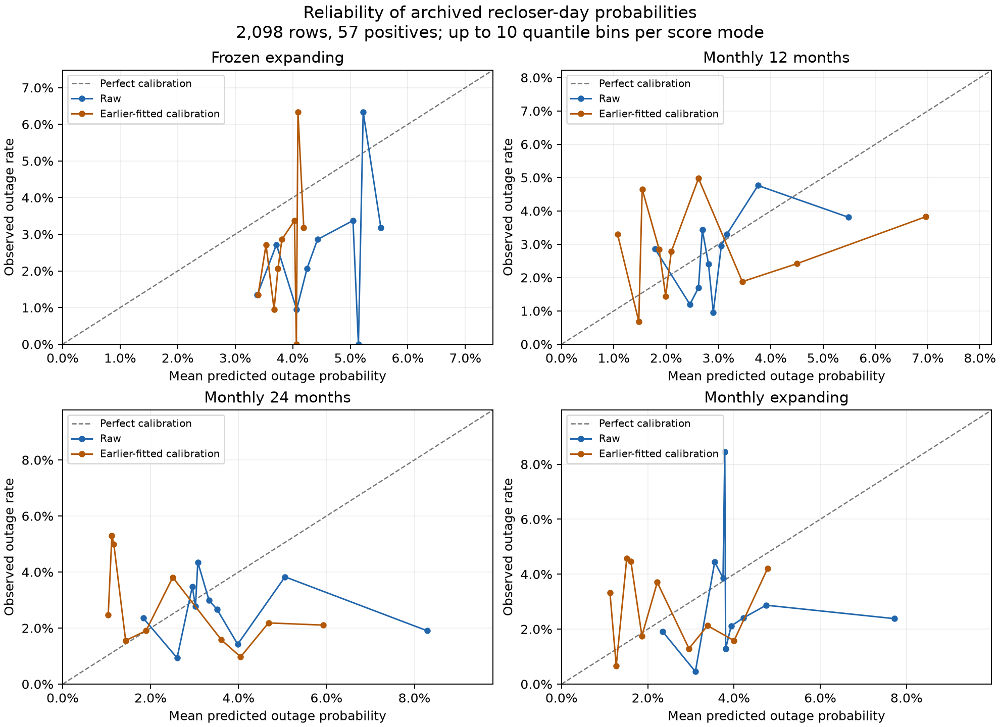

# Candidate evaluation in the requested thesis format

Same **2,098 recloser-days**, **57 positive rows** on 41 dates, January 1 to September 21, 2026. The table uses raw probabilities and the original earlier-learned **FPR20** warnings. No model, cutoff or prediction was changed.

| Training approach | AUC-ROC | F1-score | Precision | Recall | Brier score |
|---|---:|---:|---:|---:|---:|
| Frozen expanding | 0.6305 | 0.0709 | 3.72% | 77.19% | 0.026597 |
| Monthly 12 months | 0.5715 | 0.0375 | 2.04% | 22.81% | 0.026495 |
| Monthly 24 months | 0.5011 | 0.0470 | 2.55% | 29.82% | 0.026980 |
| Monthly expanding | 0.5157 | 0.0171 | 1.13% | 3.51% | 0.026760 |

AUC-ROC measures ranking across cutoffs (0.5 is chance-level ranking). F1 is the harmonic mean of precision and recall at the saved warning rule. Brier score is the mean squared error of predicted outage probabilities (lower is better). AUC-ROC and Brier use continuous probabilities, not thresholded warnings.

| Training approach | Detected | False warnings | Missed | True negatives |
|---|---:|---:|---:|---:|
| Frozen expanding | 44/57 | 1,140 | 13 | 901 |
| Monthly 12 months | 13/57 | 623 | 44 | 1,418 |
| Monthly 24 months | 17/57 | 649 | 40 | 1,392 |
| Monthly expanding | 2/57 | 175 | 55 | 1,866 |

The monthly 12-month balanced-accuracy rule remains a separate operating point: 42/57 detected with 1,255 false warnings. All five warning policies and both probability modes are in [all_warning_policies.csv](all_warning_policies.csv). When no warnings are issued, the CSV uses the zero-division convention precision=0 and flags `precision_defined=False`.

## Calibration analysis

Observed outage frequency is **57/2,098 = 2.7169%**. Calibration asks whether predicted probabilities match observed frequencies; it is distinct from detecting outages at a cutoff. The previously fitted frozen sigmoid and monthly intercept adjustments are compared with raw scores below. They are not refitted on these evaluation outcomes.

| Training approach | Probability mode | Mean probability | Observed rate | Brier score | ECE (10 quantile bins) |
|---|---|---:|---:|---:|---:|
| Frozen expanding | raw | 4.40% | 2.72% | 0.026597 | 0.019135 |
| Frozen expanding | monotone_sigmoid | 3.79% | 2.72% | 0.026489 | 0.015420 |
| Monthly 12 months | raw | 3.07% | 2.72% | 0.026495 | 0.009331 |
| Monthly 12 months | intercept_adjusted | 2.75% | 2.72% | 0.026780 | 0.016536 |
| Monthly 24 months | raw | 3.75% | 2.72% | 0.026980 | 0.015676 |
| Monthly 24 months | intercept_adjusted | 2.70% | 2.72% | 0.026967 | 0.021687 |
| Monthly expanding | raw | 4.08% | 2.72% | 0.026760 | 0.019713 |
| Monthly expanding | intercept_adjusted | 2.43% | 2.72% | 0.026615 | 0.016662 |

Points below the diagonal indicate predicted risk exceeding the observed rate in that bin. Points above it indicate predicted risk below the observed rate. Each score mode has up to 10 equal-frequency bins, keeping tied scores together. Bin counts, positives, probability ranges and observed rates are in [reliability_bins.csv](reliability_bins.csv). ECE is the bin-size-weighted absolute difference between mean probability and observed rate. It depends on binning and is descriptive. With only 57 positives and correlated rows across dates/reclosers, bin frequencies can be noisy.

A small Brier score alone can be misleading when outages are rare. The always-zero probability reference scores **0.027169** here. A more informative reference predicts the outage rate from each candidate's earlier calibration data, fixed for the frozen model and updated only from earlier data for monthly models. No evaluation labels set those reference probabilities. The following skill scores compare against that reference (positive is better):

| Training approach | Probability mode | Earlier-rate reference Brier | Brier skill |
|---|---|---:|---:|
| Frozen expanding | raw | 0.026497 | -0.38% |
| Frozen expanding | monotone_sigmoid | 0.026497 | 0.03% |
| Monthly 12 months | raw | 0.026524 | 0.11% |
| Monthly 12 months | intercept_adjusted | 0.026524 | -0.96% |
| Monthly 24 months | raw | 0.026524 | -1.72% |
| Monthly 24 months | intercept_adjusted | 0.026524 | -1.67% |
| Monthly expanding | raw | 0.026524 | -0.89% |
| Monthly expanding | intercept_adjusted | 0.026524 | -0.34% |

### Interpretation

The frozen raw model averages 4.40% predicted risk against 2.72% observed outages. Its earlier-fitted calibration reduces that average to 3.79%, and reduces Brier score from 0.026597 to 0.026489, but it still overpredicts on average.

The monthly 12-month adjustment brings the mean prediction close to the observed rate (2.75%), yet worsens Brier score from 0.026495 to 0.026780 and increases binned calibration error. Matching the overall outage frequency does not establish reliable probabilities for individual risk groups. Across these candidates, Brier skill relative to the earlier-rate reference is near zero or negative, so the small absolute Brier scores do not demonstrate a substantial probability-prediction improvement over that reference.

For monthly candidates, AUC-ROC is pooled across all evaluation months. An intercept adjustment preserves ranking within a month but can change pooled AUC by changing ranking across months. The frozen monotone calibration preserves its overall ordering.

These reports use the existing retrospective evaluation population and do not select a new main model from the examined 2026 results. Low precision and the false-warning counts remain material to interpretation even where recall is high.

## Reproduce

`python report_candidate_metrics.py`

The script independently recomputes all 40 candidate/mode/policy metric rows and compares them with archived scores. Input hashes and verification are in [verification.json](verification.json). Original data, models and archived reports remain unchanged.
