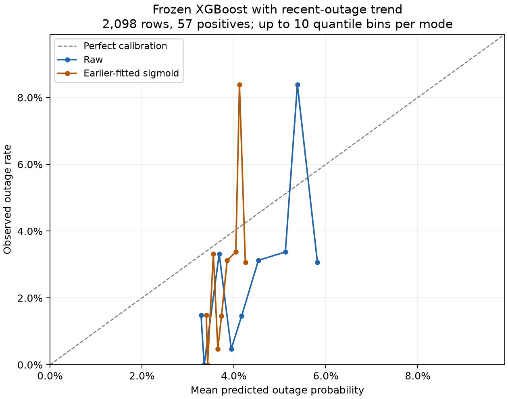

# Featured frozen XGBoost with recent-outage trend

This is the **original-tuning recent-outage-trend candidate**, featured at the
user's request after exploratory evaluation. It uses expanding historical training,
with one final frozen model and no monthly refitting. It was not the feature set
selected by the earlier development comparison.

Same 2,098 eligible recloser-days, 57 positives on 41 dates, January 1 through
September 21, 2026. Raw probabilities and the earlier-learned FPR20 policy:

| Model | AUC-ROC | F1-score | Precision | Recall | Brier score |
|---|---:|---:|---:|---:|---:|
| Frozen XGBoost/history + recent-outage trend | 0.6343 | 0.0768 | 4.07% | 66.67% | 0.026588 |

Confusion counts: **38 true positives, 895 false positives, 19 false negatives,
1,146 true negatives**. Raw FPR20 cutoff: **0.04553172364830971**. This cutoff was
learned on earlier calibration records; FPR20 does not guarantee a 20% future FPR.

## Feature and fitting details

The model has the original nine history inputs plus
`outage_rate_recent3d_minus_previous4d`:

```text
outage_days_prev3d / 3
  - (outage_days_prev7d - outage_days_prev3d) / 4
```

This compares the daily outage rate over the last three days with the preceding
four days. It reexpresses existing counts and adds no new observations. The
counts exclude target day D and use posts published by D-1 20:00 PHT. Equipment
history remains limited to 7/14 days. No weather or vegetation predictors are used.

The final model uses depth 3, L2 regularization 30 and 18 boosting rounds, selected
using the original four-trial log-loss procedure on earlier tuning data. Refit:
September 30, 2022 through September 16, 2025, 7,619 eligible rows / 322 positives.
Calibration: October 1 through December 17, 2025, 623 rows / 22 positives. Four
earlier chronological development fits and their records are included in the
model folder. Mean earlier development AUC is 0.5278.

## Calibration analysis

| Probability mode | Mean predicted risk | Observed rate | Brier score | ECE, up to 10 quantile bins |
|---|---:|---:|---:|---:|
| Raw | 4.42% | 2.72% | 0.026588 | 0.021487 |
| Earlier-fitted sigmoid | 3.80% | 2.72% | 0.026487 | 0.017143 |



Earlier-fitted calibration reduces average overprediction and Brier score,
although predicted risk still exceeds the observed frequency on average.
Reliability-bin counts and observed frequencies are in
[reliability_bins.csv](reliability_bins.csv). The small absolute Brier scores must
be interpreted alongside the rare positive rate; an always-zero probability
reference scores 0.027169 on these rows.

## Original baseline comparison

| Candidate | AUC-ROC | F1-score | Precision | Recall | Brier score | Detected /57 | False warnings |
|---|---:|---:|---:|---:|---:|---:|---:|
| Original nine-input baseline | 0.6305 | 0.0709 | 3.72% | 77.19% | 0.026597 | 44 | 1,140 |
| Featured trend candidate | 0.6343 | 0.0768 | 4.07% | 66.67% | 0.026588 | 38 | 895 |

The AUC increase is **0.0038**. Its exploratory paired 95% change interval is
approximately **[-0.0089, +0.0169]**, from 500 moving-block resamples of seven
calendar days. It includes zero and is not adjusted for feature comparisons.
The trend candidate issues fewer false warnings but detects six fewer positives.
The examined 2026 data cannot establish independent confirmation of the choice.

## Files and verification

- [Final model, four development fits and learned rules](../../models/recent_outage_trend/)
- [All ten probability-mode/warning-policy metric rows](metrics.csv)
- [Calibration summary](calibration_summary.csv)
- [Verification result](verification.json)

Run `python verify_recent_outage_trend.py` from the repository root to reload
all five included trend fits and reproduce saved probabilities and warnings.
Run `python train_recent_outage_trend.py --output refits/recent_trend` for a new
chronological refit using the supplied original source features and cohorts.
